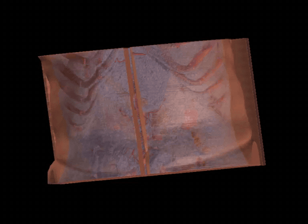
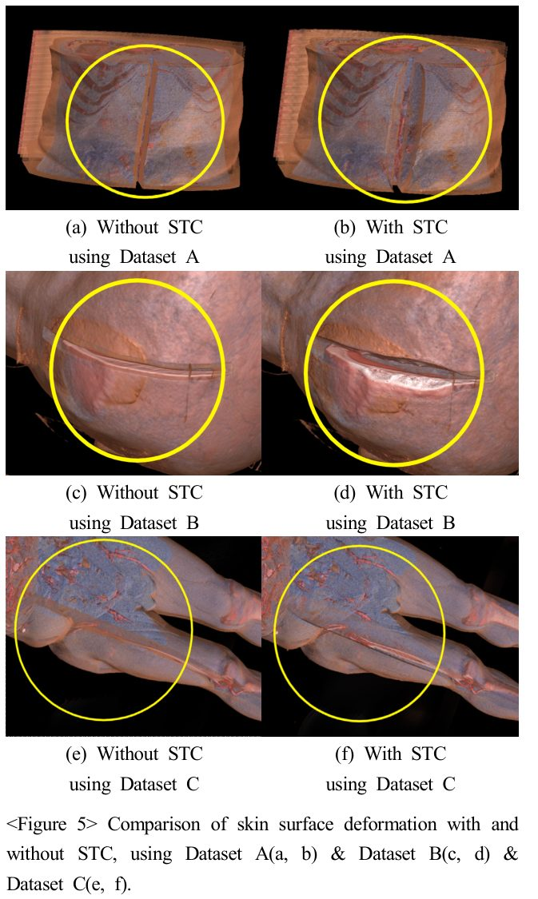

<picture>
  <source media="(prefers-color-scheme: dark)" srcset="images/header-dark.svg">
  
</picture>

<p align="center">
  <a href="https://soz1p.github.io/jeon-sojin-portfolio/#p-stc"><b>Portfolio (KO)</b></a> &nbsp;·&nbsp; <a href="https://soz1p.github.io/jeon-sojin-portfolio/?lang=en#p-stc"><b>Portfolio (EN)</b></a> &nbsp;·&nbsp; <a href="papers/stc-2025.pdf"><b>Paper PDF</b></a> &nbsp;·&nbsp; <a href="https://www.kci.go.kr/kciportal/landing/article.kci?arti_id=ART003238324"><b>KCI</b></a>
</p>

<p align="center">
       
</p>

> **핵심 기여** &nbsp; 피부 인장 반응을 표현하는 새로운 PBD 제약 STC를 제안하고 구현해, 제1저자로 학술지 논문을 게재했습니다.

<p align="center"></p>
<p align="center"><sub>실행 화면 · STC를 적용한 PBD 변형에서 절개 부위가 피부 장력으로 벌어지는 모습</sub></p>

## At a glance

| 1st | 3 | 3.23 – 7.66% |
| :---: | :---: | :---: |
| 학술지 논문 제1저자 | CT 데이터셋 비교 실험 | 병렬 리샘플링 시간 증가율 |

**Pipeline** &nbsp; CT density → Skin surface detection → STC projection (CUDA) → Volume visualization

## STAR

| | |
| :-- | :-- |
| **S** · 상황 | 기존 PBD 인체 변형은 거리·부피 제약 중심이라, 절개 후 피부가 장력으로 벌어지는 현상을 충분히 표현하지 못했습니다. |
| **T** · 과제 | 피부 표면에만 작동하는 인장 제약을 설계하고, 기존 GPU 파이프라인에 성능 부담을 최소화하며 통합하는 것이 목표였습니다. |
| **A** · 내가 한 일 | • 절개 전후 변형을 비교해 기존 제약 조건의 한계를 정의했습니다.<br>• CT 밀도와 전달 함수로 공기 정점이 하나뿐인 사면체를 찾아 피부 표면 삼각형을 탐지했습니다.<br>• 삼각형의 기준 면적과 현재 면적의 차이로 장력을 근사하는 STC를 설계했습니다.<br>• 기존 CUDA 제약 처리 구조에 통합하고, 3개 데이터셋에서 적용 전후의 형상과 계산 시간을 비교했습니다. |
| **R** · 결과 | 절개 주변 피부가 벌어지는 모습을 시각적으로 개선했고, 병렬 리샘플링 시간 증가는 3.23–7.66%에 그쳤습니다. 문제 정의부터 수식 모델, 구현, 논문 작성까지 연구 전 과정을 주도했습니다. |

## How it works

### 1 · 피부 표면 탐지: 공기 정점이 하나뿐인 사면체

피부는 몸이 외부 공기와 맞닿는 경계에서 생깁니다. 사면체의 네 정점 중 공기로 분류되는 정점이 **정확히 하나**일 때만, 나머지 세 정점이 이루는 면을 피부 표면으로 등록합니다.

| 공기 정점 0개 | 공기 정점 1개 | 공기 정점 2개 이상 |
| :---: | :---: | :---: |
| 내부 조직 · 제외 | **나머지 세 정점의 면을 피부로 등록** | 경계 불명확 · 제외 |

1. **밀도 → 불투명도** &nbsp; CT의 HU 값을 AlphaTable 전달 함수로 변환합니다. −449 HU 미만은 공기(α = 0), −449 ~ 6 HU는 선형 증가, 6 HU 초과는 완전 불투명입니다.
2. **정점 분류** &nbsp; α = 0이면 공기, α > 0이면 피부로 봅니다. 임곗값은 데이터에 맞춰 조정할 수 있습니다.
3. **사면체 판정** &nbsp; 공기 정점 수가 정확히 1개일 때만 삼각형을 만듭니다.
4. **제약 초기화** &nbsp; 삼각형마다 세 정점 인덱스, 기준 면적, 정점 밀도 평균으로 정규화한 강성 계수를 저장합니다.

```python
# 논문 알고리즘 설명용 의사코드 (연구실 구현은 비공개)
for tet in tetrahedra:
    air = [v for v in tet if alpha[density(v)] == 0]
    if len(air) == 1:
        tri = tet - air                       # 나머지 세 정점
        register_skin(tri,
                      rest_area = area(tri),
                      stiffness = normalize(mean_density(tri)))
```

연속된 외피만 활성화되므로 내부 구조에는 장력이 걸리지 않고, 제약 수도 표면 삼각형 수로 줄어듭니다.

### 2 · 등록한 면에 거는 장력 제약

| 식 | 의미 |
| --- | --- |
| `A = ½ ‖(p₂ − p₁) × (p₃ − p₁)‖` | 현재 면적 |
| `C = A − A_rest` | 제약 위반량 |
| `s = 1 + β · max(0, C / A_rest)` | 늘어날 때만 복원 계수 증폭 |
| `∇pᵢ A = ½ (e_opp × n̂)` | 면적 그래디언트 |

면적이 기준보다 커질 때만 복원 계수를 키워, 늘어난 피부가 원래 크기로 당겨지는 반응을 만듭니다. 보정량은 역질량과 면적 그래디언트로 세 정점에 나눕니다.

### 3 · CUDA 파이프라인 통합

STC는 삼각형 단위의 독립 제약이라 기존 병렬 그룹핑과 충돌 없이 결합됩니다. 한 프레임마다 거리 제약 → STC 순서로 제약 투영을 5회 반복하고, 각 단계는 CUDA로 병렬 처리합니다.

## Results

<p align="center"></p>
<p align="center"><sub>게재 논문 Figure 5 · 왼쪽 STC 미적용, 오른쪽 적용 (Dataset A, B, C)</sub></p>

| Dataset · PBD resolution | 그룹핑 (ms) | 증가 | 병렬 리샘플링 (ms) | 증가 |
| --- | ---: | ---: | ---: | ---: |
| A · 129×129×76 | 1447 → 1493 | 3.18% | 74.06 → 79.73 | 7.66% |
| B · 129×129×138 | 2753 → 2773 | 0.73% | 126.52 → 131.89 | 4.24% |
| C · 129×129×289 | 5384 → 5438 | 1.00% | 257.75 → 266.08 | 3.23% |

<sub>게재 논문 5.4절, Table 4 · NVIDIA GeForce RTX 3090 · 리샘플링 시간은 연속 10프레임 평균. 병렬 리샘플링 단계 기준이며 전체 FPS나 임상적 정확도를 뜻하지 않습니다.</sub>

STC는 피부 표면 경계에만 적용되어 연산 대상 요소 수가 전체 볼륨에 걸친 거리·부피 제약의 10% 이하이므로, 세 데이터 모두 그룹핑 시간과 커널 단위 병렬 처리 성능에 큰 차이가 없었습니다.

## Follow-up · ASTC

STC는 늘어난 방향과 무관하게 같은 세기로 당기는 **등방성** 제약입니다. 후속 연구 ASTC(Anisotropic Skin Tension Constraint)에서는 절개 중심에서 각 삼각형으로 향하는 선호 방향 `d`를 두고, 방향 정렬 변형에 가중치를 주어 기존 STC 보정량에 곱했습니다. 2026 한국컴퓨터그래픽스학회 학술대회 포스터로 발표했으며, 수식 설계·코드 구현·원고 작성을 담당했습니다. 정식 논문 전 예비 결과이므로 위 게재 수치와 구분합니다.

## Limitations

절개 형상의 정성 비교로 면적 기반 제약의 적용 가능성을 확인했습니다. 조직의 실측 물성과의 일치, 임상적 정확도, 다양한 절개 조건에 대한 일반화는 별도 검증 과제입니다.

## Publication

**STC: A Skin Tension Constraint Model for Position-Based Dynamics**
전소진 · 서지완 · 계희원
한국컴퓨터그래픽스학회 논문지 31(4), 21–31, 2025 · DOI [10.15701/kcgs.2025.31.4.21](https://doi.org/10.15701/kcgs.2025.31.4.21)

[Paper PDF](papers/stc-2025.pdf) · [KCI landing page](https://www.kci.go.kr/kciportal/landing/article.kci?arti_id=ART003238324)

## Source availability & license

연구실 및 공동 연구의 소스코드와 원본 CT 데이터는 공개하지 않습니다. 이 저장소는 연구 소개와 공개된 논문 정보를 정리한 페이지입니다.

논문 원문은 KCI에 명시된 [CC BY-NC 3.0](https://creativecommons.org/licenses/by-nc/3.0/) 조건에 따라 변경 없이 제공합니다. 비교 이미지는 해당 논문 Figure 5입니다. 이 조건은 연구실 소스코드의 공개 허가를 의미하지 않습니다.

---

<sub>전소진 · Jeon Sojin · Graphics Engineer &nbsp;|&nbsp; <a href="https://soz1p.github.io/jeon-sojin-portfolio/">Portfolio</a> · <a href="https://github.com/soz1p">GitHub</a> · <a href="https://www.linkedin.com/in/soz1p">LinkedIn</a> · jeonsoz1p@gmail.com</sub>
